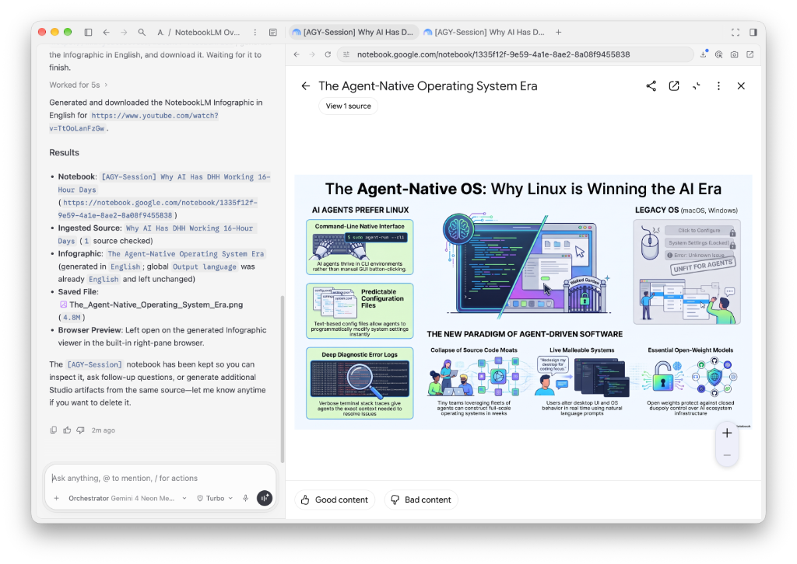

# Antigravity NotebookLM

An Antigravity plugin for [Google NotebookLM](https://notebook.google.com) exposing a single `notebooklm` skill with an interactive 2-step Studio Workbench, built-in browser preview, and automatic local downloads.

## Installation

### Option 1 — Antigravity CLI

```bash
git clone https://github.com/WeZZard/antigravity-notebooklm.git
agy plugin install ./antigravity-notebooklm
```

### Option 2 — Direct Clone into Plugins Directory

```bash
git clone https://github.com/WeZZard/antigravity-notebooklm.git \
  ~/.gemini/config/plugins/antigravity-notebooklm
```

### Prerequisites

- Antigravity with the built-in browser enabled
- Python 3 (for the bundled `studio-ui` MCP App server)
- A Google account signed into `https://notebook.google.com`

## Quick Usage

- Run `/notebooklm` to launch the interactive 2-step Studio Workbench, pick deliverables and output language, attach sources, and click **Launch**.
- Or prompt directly in chat (for example, extract a YouTube transcript, generate a Slide Deck, Infographic, Audio Overview, or Quiz, or ask citation-verified questions). Generated artifacts stay open in the built-in right-pane browser and download automatically to `./notebooklm-outputs/`.

## Screenshots

1. **Step 1 — Pick deliverables and output language**

   

2. **Step 2 — Add data sources and launch**

   

3. **Result — Right-pane browser preview & local download**

   

## Capabilities

- **Sources**: YouTube and web URLs, local files, pasted text, Google Drive, Play Books, Textbooks, and Web/Drive research (`Fast Research` / `Deep Research`).
- **Studio Deliverables**: Audio Overview, Slide Deck, Video Overview, Mind Map, Reports (`Study Guide`, `Timeline`, `FAQ`), Flashcards, Quiz, and Infographic.
- **Grounded Q&A & Session Management**: Inline citation verification (`[1]`, `[2]`), configurable chat style/length, and automatic `[AGY-Session]` notebook lifecycle management.

## Validation & Maintenance

```bash
agy plugin validate . --strict
python3 tests/validate_plugin.py --check-loader
```

Maintainers can run `/notebooklm-sync` ([.agents/skills/notebooklm-sync/SKILL.md](./.agents/skills/notebooklm-sync/SKILL.md)) to audit and synchronize the plugin against live NotebookLM UI updates.
